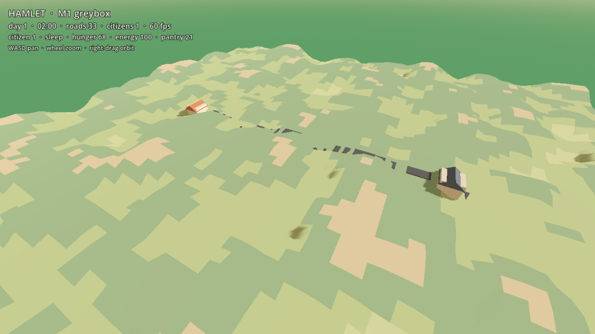

<p align="center">
  <a href="https://github.com/ewanc26/hamlet/actions/workflows/ci.yml"></a>
  <a href="https://github.com/ewanc26/hamlet/releases/latest"></a>
  <a href="LICENSE"></a>
  <a href="https://github.com/sponsors/ewanc26"></a>
</p>

# hamlet

*a city-to-country builder* — every citizen a persistent, autonomous agent.



Godot 4.7 · C#/.NET simulation core · GDScript presentation · AGPL-3.0

Hamlet grows from a handful of settlers on empty land to a nation of specialised,
trading settlements — one continuous simulation at every scale. The full design
document lives in [docs/project-brief.md](docs/project-brief.md).

## The split

| Side | Language | Lives in |
| --- | --- | --- |
| Simulation core (engine-agnostic, deterministic, headless) | C# | `sim/` |
| The single Godot boundary Node (thread + signals) | C# | `host/` |
| Presentation, UI, tools | GDScript | `ui/`, `scenes/` |
| Headless console harness | C# | `headless/` |
| Tests incl. the determinism gate | C# | `tests/` |

Rules: one C# Node only (`SimHost`); cross-language calls happen only at tick
boundaries; the sim never touches the scene tree. Full contract in the brief, §4.

## Roadmap

The milestone ladder M0–M6 — versions, exit criteria, and where we are — lives
in [ROADMAP.md](ROADMAP.md). Art direction: diorama minimalism,
flat-shaded, green ([docs/art-direction.md](docs/art-direction.md)).

## File architecture

Every file is an atom — one concept per file — at `<scope>/[subscope/]<atom>.<ext>`:
lowercase scopes (`sim`, `host`, `tests`), at most one subscope level (`sim/core`),
C# atoms named exactly for their class (`SimHost.cs` — Godot requires it),
snake_case GDScript atoms (`hud.gd`), and one JSON file per content entity
(`data/samples/bakery.json`).

## Build & test

The .NET 8 SDK is all you need for the sim; the Godot 4.7 editor (.NET build)
is only required to run the game itself.

```sh
dotnet test tests/Hamlet.Sim.Tests.csproj
dotnet run --project headless -- 12345 10000 128
```

The suite includes the determinism gate: the same seed and command stream must
produce a bit-identical state hash on every run, on every machine, in CI.

## Run the game

```sh
godot --path .            # the M1 greybox: terrain, road, home, workplace, one citizen
godot --path . -- --stress=1000   # 1,000 extra settlers on the strip (M0 budget check)
```

WASD pans, the wheel zooms, right-drag orbits. The HUD shows the sim clock, the
lead citizen's activity and needs, and the frame rate; every number is a real
value batched across the C# boundary once a second.

## Licence
AGPL-3.0 — see [LICENSE](LICENSE).
## Contributing

See [CONTRIBUTING.md](CONTRIBUTING.md) for the workflow and the checks required before opening a pull request.
