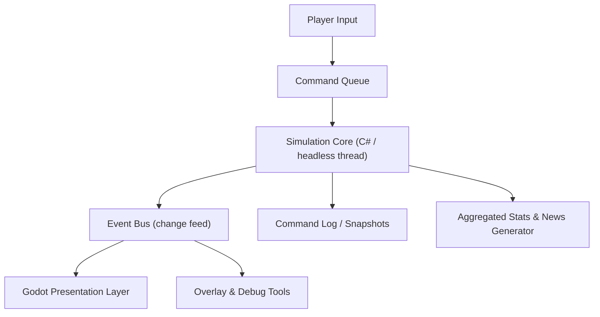
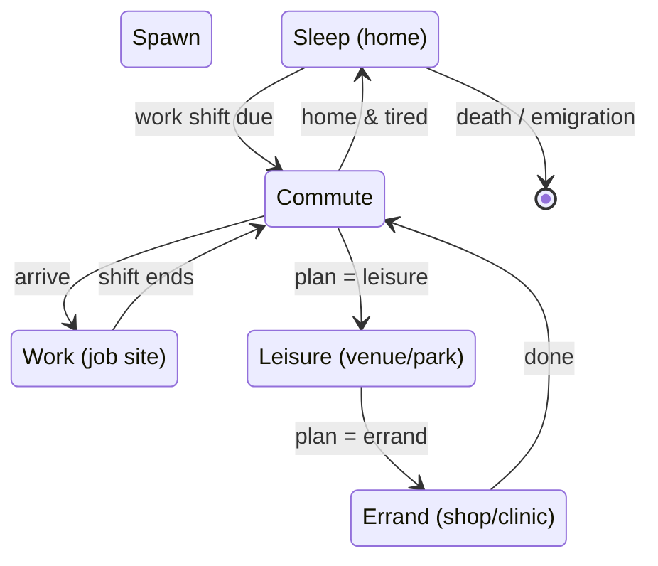

# Project Brief: Hamlet — an Autonomous Citizen City-to-Country Builder in Godot

**Codename:** *Hamlet* · **Repo:** [github.com/ewanc26/hamlet](https://github.com/ewanc26/hamlet) · **Status:** M1 complete (v0.2.0) — M2 A Living Street in progress · **Platform:** Desktop (Windows/Linux/macOS) · **Engine:** Godot 4.7 (current stable) — see §13 for the research basis of this revision

---

## 1. Vision

A grid-based builder where the settlement is not a machine you program, but a society you observe — and where the map grows from a single hamlet to a whole nation. Every citizen is a persistent, autonomous agent with needs, a job, a home, opinions, relationships, and a daily life. Traffic jams, rent spikes, crime waves, and neighbourhood revivals emerge from thousands of individual decisions — never from a spreadsheet formula applied top-down.

The arc is the product. The game opens with a handful of settlers on empty land, and the same simulation systems carry that hamlet through village, town, and city until it anchors a region of specialised, trading settlements — and finally a country. Settlements you found later run the exact same agent simulation; growth never swaps agents for a spreadsheet.

The player never controls a citizen directly. The player is the *policy layer*: zoning, roads, services, taxes, and ordinances — at settlement scale first, then national: inter-city infrastructure, trade policy, migration law. Citizens respond to incentives and each other. Success is measured by their wellbeing, not by your treasury alone.

**The pitch in one line:** *Dwarf Fortress depth of simulation at Cities: Skylines readability, growing from one hamlet to a nation in a single Godot project.*

---

## 2. Design Pillars

1. **Every citizen is real — wherever you look.** Any person in any settlement can be clicked: name, job, home, needs, relationships, and what they're currently thinking about. Off-focus agents collapse into statistical form but resurrect fully the moment you inspect them.
2. **One simulation, every scale.** The same agent systems run from a six-house hamlet to a nation of connected settlements. Growth changes the camera and the LOD budget, never the rules — the late game is never a different game.
3. **Emergence over scripting.** No "if population > 500 then build landmark fires". Outcomes arise from agent behaviour.
4. **Readable complexity.** Deep simulation, but with strong visualisation and overlay tools so the player never debugs blind.
5. **Deterministic simulation.** Same inputs → same city. Enables input-replay saves, desync-free testing, and post-mortem debugging.
6. **Mod-friendly.** Data-driven citizens, buildings, and policies in plain resource files; no core logic hardcoding content.

## 2.1 Non-Goals (v1)

- No multiplayer.
- No 3D photorealism — stylised 2.5D/low-poly 3D instead.
- No citizen *control*: no direct orders, only policy.
- No terraforming or free-form roads in v1 (grid roads only).
- No military/external threats. Pressure is internal: economy, happiness, housing.
- No rival AI nations or diplomacy in v1 — the nation you grow is the only one on the map.

---

## 3. Core Gameplay Loop

1. **Plan** — zone residential/commercial/industrial, draw roads, place services.
2. **Attract** — citizens immigrate based on city attractiveness (jobs, housing, taxes, reputation).
3. **Live** — citizens autonomously commute, shop, socialise, and rest; their aggregated behaviour produces demand for goods, labour, and land.
4. **React** — read the overlays, hear the news ticker (events generated from actual agent experiences), adjust policy.
5. **Grow or decline** — a settlement that mistreats citizens loses them; unemployment and unhappiness feed back into immigration, rents, and business survival.

Past the city stage, the loop gains a second octave: **found** a new settlement on the same map, **connect** it with inter-city infrastructure, **specialise** it (port, mining town, farming hub), and let households **migrate** between settlements — every mover a real agent making a real decision.

### 3.1 The Scale Ladder

The campaign is one continuous arc across five tiers. Each tier is defined by what the simulation guarantees, not by map size alone:

| Stage | Population per settlement | Simulation guarantee |
|---|---|---|
| **Hamlet → Village** | < 500 | every citizen fully simulated, nearly all on-screen |
| **Town** | 500–5,000 | full planner for all agents; LOD tiers 2–3 active off-camera; household bodies merge shared family trips (§6.6) |
| **City** | 5,000–10,000 | the focus settlement holds the full agent budget (§8); cohort bodies compress compatible commuters off-camera (§6.6) |
| **Region** | 2+ settlements | one focus settlement fully simulated; siblings run as single settlement bodies (§6.5–6.6), agents resurrected on inspection or events |
| **Nation** | 10+ settlements | all non-focus settlements run as single settlement bodies (§6.6); migration and trade between them simulated as real (sampled) journeys with real agents |

---

## 4. Technology Stack

| Layer | Choice | Rationale |
|---|---|---|
| Engine | Godot 4.7 (stable), Forward+ renderer | Current stable line — Godot.NET.Sdk 4.7.2 published on NuGet with 4.8 in beta ([NuGet: Godot.NET.Sdk version index](https://api.nuget.org/v3-flatcontainer/godot.net.sdk/index.json)); open source, no licensing |
| Gameplay & UI code | GDScript | Fast to write with the tightest editor integration; ideal for UI, overlays, input, camera, tools, and balance tuning |
| Simulation core | **C# / .NET** | Compiled speed for needs scoring, planning, pathfinding, and agent loops at 10k+ citizens; a plain class library that also runs headless |
| Escape hatch (deferred) | C++ via GDExtension | Only if a specific kernel (e.g. flow-field floods) proves too slow in C# — out of scope for v1 |
| Data format | `Resource` files (`.tres`) + JSON schemas for mods | Data-driven content, moddable |
| Saves | Command log (input replay) + periodic snapshot | Determinism makes replay cheap and desync-debuggable |
| UI | Godot Control nodes + a custom overlay/canvas system for heatmaps | |
| Tests | GUT (GDScript) + xUnit for the C# sim core | CI via GitHub Actions |

**Key rule: the language split follows the data.** The simulation core is a plain C# class library (`Hamlet.Sim`) — no Node types, no scene-tree access — running on a dedicated background thread, compilable to a headless CLI for tests, replay verification, and overnight balance runs. GDScript owns everything that touches the scene tree or the editor. Godot's own guidance endorses exactly this pairing: GDScript for fast-to-write gameplay code, C# "to implement complex algorithms and maximize their performance" ([Godot docs: Scripting languages](https://docs.godotengine.org/en/stable/getting_started/step_by_step/scripting_languages.html)).

**C# platform reality check.** Since Godot 4.2, C# supports all desktop platforms (plus experimental Android/iOS), but cannot export to the web ([Godot docs: C#/.NET](https://docs.godotengine.org/en/4.6/tutorials/scripting/c_sharp/index.html)). Hamlet is desktop-only, so this costs nothing; it only matters if a web demo ever becomes a marketing goal.

**Evaluated and deferred: full ECS.** Stagehand (Flecs as a Godot GDExtension, beta as of September 2026) is the most credible Godot-native option ([Stagehand on GitHub](https://github.com/60k41p/Stagehand)), and C# has its own mature ECS ecosystem. Rejected for v1: a dependency in the one place we need total control of iteration order for determinism. The door stays open — the C# sim data already lives in plain component arrays, so adopting an ECS later is a refactor, not a rewrite.

### The GDScript ↔ C# boundary contract

Godot happily mixes languages in one project — C# scripts instantiate from GDScript, signals cross both ways, and exported properties are visible to both ([Godot docs: Cross-language scripting](https://docs.godotengine.org/en/4.2/tutorials/scripting/cross_language_scripting.html)). But every call across the boundary pays Variant marshalling, so the split is governed by six rules:

1. **One C# Node only.** `SimHost` (an autoload) owns the sim thread. Every other C# type is a plain class, invisible to the scene tree. GDScript never holds references to sim internals.
2. **Batch at tick boundaries.** Commands flow into a queue on `SimHost`; events flow out as Godot signals emitted once per tick. Never per-frame, never per-agent cross-language calls.
3. **No shared inheritance.** The C# and GDScript class hierarchies stay independent (kept as a project rule even where the engine permits more); shared data crosses as Variant-friendly values.
4. **The sim thread never touches the scene tree.** Scene-tree interaction is not thread-safe; server APIs (with thread-safe operation enabled in project settings) and `call_deferred` are the legal crossing points ([Godot docs: Thread-safe APIs](https://docs.godotengine.org/en/stable/tutorials/performance/thread_safe_apis.html)).
5. **C# file hygiene.** A `.cs` script's class must match its filename and derive from a Godot type to be loadable by GDScript ([Godot docs: Cross-language scripting](https://docs.godotengine.org/en/4.2/tutorials/scripting/cross_language_scripting.html)), and the built-in script editor has no C# intellisense — VS Code or Rider is part of the standard setup ([Godot docs: C# API differences](https://docs.godotengine.org/en/stable/tutorials/scripting/c_sharp/c_sharp_differences.html)).
6. **Determinism lives in C#.** The sim owns its seeded PRNG (`System.Random`-style, never `GD.RandRange`), fixed-point math, and allocation-free tick loops (pooled objects, pre-sized arrays) so the .NET tracing garbage collector never fires mid-tick. GDScript needs none of this care — it is reference-counted, not garbage-collected ([Godot docs: Scripting languages](https://docs.godotengine.org/en/stable/getting_started/step_by_step/scripting_languages.html)) — one more reason it owns presentation, where per-frame allocations are cheap.

### The Data Contract (Content & Mods)

Everything content-shaped is data, in two layers:

- **Editor layer**: custom `Resource` classes (`.tres`) for buildings, activities, needs, traits, policies, goods, and calendar rates — authored in the Godot inspector, hot-reloadable, the designers' source of truth. Every measured field declares its 0–100 meaning (§5.1) so the inspector renders live bars while tuning.
- **Runtime layer**: on load, resources and mod JSON import into plain C# structs inside the sim's own arrays — the sim never touches a Godot Resource mid-tick.
- **Mods ship JSON** validated against a versioned schema; unknown fields are ignored with warnings (forward compatibility), and malformed content fails loudly at load, never mid-simulation.
- **Determinism with mods**: save headers record the full content hash set (mods + versions); replays refuse to run against a different set rather than silently desyncing.
- **Migration**: schema versions are explicit, and a migration step converts old content at load; mod-facing field names are frozen within a major version.

---

## 5. Architecture Overview

Fixed-timestep simulation decoupled from rendering. The sim runs at a constant **15 ticks/second** of game time (with time-scale multipliers), rendering interpolates. All sim state lives in plain data (structs/arrays), all presentation is rebuilt reactively from sim events.



- **Simulation core (C#)** — one contiguous world grid hosting any number of settlements, with buildings, roads, economy, and N citizen agents; updates in deterministic order (agent IDs sorted, fixed iteration) on its own thread.
- **Event bus** — the sim emits diffs (`CitizenMoved`, `BuildingOccupied`, `RentChanged`, `CitizenUnhappy`…) as Godot signals via `SimHost`. The Godot layer consumes events and updates visuals only. No polling.
- **Presentation layer** — citizens drawn as **MultiMesh** instances bucketed per district: one draw primitive per bucket covers thousands of agents in a single call, with `visible_instance_count` trimming what the camera shows — the documented pattern for thousands of instances that still need constant updates ([Godot docs: Optimization using MultiMeshes](https://docs.godotengine.org/en/latest/tutorials/optimization/using_multimesh.html)). MultiMesh offers no per-instance frustum culling, which is precisely why the buckets are per-district. Buildings as mesh instances.
- **Headless mode** — run the whole city sim in a CLI binary for testing, replay verification, and overnight balance runs.
- **Determinism precedent** — Factorio runs its whole simulation as a deterministic lockstep core with input replay, which is exactly what keeps its desync debugging tractable ([Alt-F4 #26: Putting the Multi in Player](https://alt-f4.blog/ALTF4-26/)). Hamlet copies the pattern even without multiplayer: replay *is* the save format.

## 5.1 The 0–100 Convention

Every *measured* value in the simulation — citizen needs, health, happiness, safety, opinions, relationship strength, housing quality, land value, pollution, noise, congestion, service coverage, education — lives on one shared **0–100 scale**:

- **Whole numbers are the native unit.** Values are stored, displayed, and compared as integers 0–100. The UI reads them as percentages; every threshold and event trigger is defined on the same scale (e.g. hunger < 15 raises an urgent eat intent; city opinion < 20 is emigration risk; clinic coverage ≥ 60 keeps the health curve positive).
- **Floats are allowed between them.** Decays, growth, and aggregations compute in floating point (or fixed-point) and quantise back to whole numbers on write. Sub-integer precision exists during a tick, never between ticks.
- **Counts, IDs, and money are exempt.** Populations, body mass, prices, wages, and the treasury keep their natural units — the convention governs scalar *measures*, not quantities. Categorical fields (job tier, life stage, body type) stay categorical.
- **One scale, every tool.** Because every metric shares the range, overlays, the inspector, and the mod data schema all use a single normalisation: 0 = absent/critical, 50 = acceptable baseline, 100 = saturated. Modders write thresholds against known anchors; balance passes compare unlike systems on one axis.
- **Determinism bonus.** Integer quantisation on write keeps the fixed-point sim stable across platforms — floats never persist, so replay diffs are exact and save states hash cleanly.

## 5.2 Proposed Project Structure

```text
hamlet/                        # repo root = Godot project root
├── project.godot             # Godot project (GDScript presentation)
├── Hamlet.csproj             # Godot game project (Godot.NET.Sdk): compiles host/, references sim/
├── hamlet.sln                # solution: game, sim, headless, tests
├── sim/                      # Hamlet.Sim — C# class library, no Godot deps
│   ├── core/                 # clock, simulation, deterministic-random, sim-command, sim-event, state-hash
│   ├── agent/                # needs, citizen, agent-body
│   ├── city/                 # world-grid, terrain-gen, place-road, road-graph
│   └── economy/              # ledger
├── host/                     # SimHost.cs — the only C# Node (thread + boundary)
├── headless/                 # CLI runner for tests, replays, balance runs
├── tests/                   # Hamlet.Sim.Tests + one atom per test area (tests/sim/…)
├── ui/                       # GDScript presentation atoms (hud.gd, overlays…)
├── scenes/                   # Godot scenes
├── data/                     # content atoms — one JSON file per entity (data/samples/bakery.json…)
└── docs/                     # project brief, architecture decisions
```

**Atomic file architecture (standing rule).** Every file is an atom — one concept per file — at `<scope>/[subscope/]<atom>.<ext>`: lowercase scopes (`sim`, `host`, `ui`, `data`), at most one subscope level (`sim/core`), and the atom named for its single concept. C# atoms take their class's PascalCase name (`SimHost.cs`, required by Godot's file-class matching); GDScript and JSON atoms are snake_case or kebab-case. A tightly-bound family (e.g. the command or event kinds) counts as one concept when splitting would separate things that never change apart. Platform-enforced paths (`.github/workflows/`) are the only exceptions.

## 5.3 Save & Replay Format

- **Replay is the save**: the primary format is a command log — ordered `(tick, command type, payload)` entries, checksummed every 512 ticks.
- **Keyframes**: a full state snapshot is written every 10,000 ticks (configurable), so a save *is* (latest keyframe + command tail) and long campaigns load instantly instead of replaying from year zero.
- **Verification**: loading replays the tail and verifies checksums — a corrupted or desynced save fails loudly at load, never mid-session.
- **Versioning**: the keyframe format is versioned with forward migrations; cloud saves are out of scope for v1.

---

## 6. The Citizen AI (Core of the Project)

Each citizen is a persistent agent with four cooperating subsystems: **Needs**, **Decision**, **Memory**, and **Life State**. The design goal is that no behaviour is scripted per-situation; all behaviour is the product of these systems reacting to the world and each other.

### 6.1 Needs Model

Eight scalar needs on the shared 0–100 scale (§5.1), decayed per tick, restored by activities:

| Need | Restored by | Decays with | Crisis effect |
|---|---|---|---|
| Hunger | eating (home/food shops) | time | health drain, unhappiness |
| Energy | sleeping (home) | activity | forced sleep, work errors |
| Health | healthcare access, hygiene | unmet needs, pollution | death risk |
| Safety | police coverage, lighting | crime nearby | flight/move-out |
| Comfort | housing quality, crowding | commute length | move-out intent |
| Social | meeting friends/family | isolation | unhappiness |
| Leisure | parks, venues, shops | monotony | job quit risk |
| Wealth (not a need, a constraint) | wages | rent, food, goods | bankruptcy → eviction |

Needs are *traits-modulated*: each citizen has randomised decay rates and weights (themselves expressed on the 0–100 scale) — a gregarious citizen weights Social high; an ambitious one weights career gains over leisure. This makes populations heterogeneous without per-citizen scripting.

### 6.2 Decision Layer — Utility GOAP

A hybrid planner, evaluated per agent on a staggered schedule (each agent fully replans every ~60 ticks — an *hourly* reconsideration under the default clock of §7.1; ticks in between execute the current plan). Both halves are battle-tested patterns: utility scoring for choosing *what* to do across huge agent counts ([Dave Mark, *Building a Better Centaur: AI at Massive Scale*, GDC 2015](https://archive.org/details/GDC2015Mark)), and GOAP — A\* over actions with preconditions and effects — for compiling an intent into robust, re-plannable steps ([Jeff Orkin, *Three States and a Plan: The AI of F.E.A.R.*, GDC 2006](https://www.gdcvault.com/play/1013394/Three-States-and-a-Plan)):

1. **Utility scoring** — generate candidate activities from context (`sleep`, `eat at home`, `eat out`, `work`, `visit friend`, `go to park`, `shop`, `see doctor`…). Each candidate scores `urgency(need) × trait_weight × availability(context) − cost(distance, money, time)`.
2. **GOAP** — the winning intent is compiled into a plan of primitive actions with preconditions/effects (`eat out ⇒ find venue ⇒ travel ⇒ buy food ⇒ eat`), which is robust to the world changing mid-plan (route blocked, venue closed) — the planner re-plans from the new state.
3. **Execution** — primitives are navigation + animation + state effects; failure bubbles up to the planner.

State machine below is *emergent*, not authored — these are just the states the planner reliably produces:



### 6.3 Memory & Relationships

- **Short-term memory:** last N locations and events per agent (cheap ring buffer) — "I was refused at the clinic today."
- **Long-term memory:** durable facts — my workplace, my friends, my favourite park, personal grievances, rent history.
- **Relationship graph:** typed edges (family, friend, coworker, neighbour) with a strength scalar on the shared 0–100 scale. Social need can only be met by visiting *known* agents — so social fabric is literally a network the player can stress.
- **Opinions:** aggregated sentiment toward the city (job market, safety, amenities, taxes), on the same 0–100 scale — drives emigration/immigration and the local news feed.

### 6.4 Life State & Households

Citizens age; they can couple, have children, seek better housing, lose jobs, fall ill, and die — all through the same planner plus life-stage rules operating on the household unit (the household, not the individual, handles rent, food budget, and moving decisions).

Shipped precedent: Cities: Skylines II grounds its citizens in a per-citizen **Lifepath** — school, work, illness, ageing, death — with happiness composed from well-being and health, and activities spanning work, shopping, study, crime, and medical care ([Paradox: Citizen Simulation & Lifepath](https://www.paradoxinteractive.com/games/cities-skylines-ii/features/citizen-simulation-lifepath)). Hamlet's differentiator: our lifepath is produced *entirely* by the planner, needs, and relationship graph, never by scripted life-stage triggers.

### 6.5 Simulation LOD (What Makes a Nation Possible)

| Tier | When | Behaviour |
|---|---|---|
| **Full** | on/near camera, recent events | complete planner, tick-by-tick needs |
| **Standard** | off camera | full needs, staggered replanning (every 60 ticks), coarse movement (teleport between anchor points, no per-frame nav) |
| **Statistical** | off camera, stable routine | agent reduced to a schedule record; daily outcomes sampled from distributions; resurrected to full tier on any inspection or event |
| **Settlement** | non-focus settlements (region/nation stages) | the whole settlement runs as one statistical unit (population, economy, sentiment sampled daily); individual citizens persist as records and are instantiated on demand |

Time-slicing is uniform: no agent ever updates everything every tick; work is spread across buckets so tick cost is flat and predictable. The settlement tier is the same idea one level up — and because every citizen record persists, nobody is ever "fake": a household that migrates arrives in its new settlement with relationships, memories, and opinions intact.

### 6.6 Citizen Bodies — Stage-Dependent Aggregation

Depending on the settlement's stage, groups of citizens may **merge into a single simulated body**: one planner instance, one movement body, one aggregated state, carrying N citizens. The population count always reflects the constituents — a body is an optimisation wrapper, never a new species of agent.

| Stage | Body type | Who merges |
|---|---|---|
| Hamlet → Village | *none* | merging disabled — every citizen individual |
| Town | **Household body** | family members with compatible intents merge for shared trips (shopping, errands, outings) |
| City | **Cohort body** | off-camera citizens sharing a home cluster, workplace, and schedule merge into commuter/shopper bodies — the mechanism that fits 10k inside the tick budget |
| Region → Nation | **Settlement body** | a non-focus settlement's community simulates as one body whose state *is* the settlement's; named citizens instantiate on demand |

**Merge legality.** A merge is only legal when the members' intents are compatible — same activity, same destination region, overlapping time window. The planner then treats the body as one agent with a *mass*: a body of 30 occupies 30 road-capacity slots, buys 30 groceries, books 30 clinic slots. The city's accounting always stays truthful.

**De-merge triggers.** Camera focus or inspection, a divergent member event (one citizen's need crisis splits the body), a heterogeneous destination, or a player query. De-merge must be lossless: the body carries the *distribution* of member needs (a histogram over the 0–100 scale, not just means) plus the persistent member records, and reconstruction is a pure function of (records, body state) — deterministic and iteration-order-independent.

**Rendering & storytelling.** A body renders as one MultiMesh instance with a count badge; a body's events carry the full member set, and the news storyteller names a constituent for narrative ("the Dòmhnallach household") while the record keeps everyone.

**Precedents.** The dual representation — discrete agents and a single continuous system — is exactly how Narain et al. simulated dense crowds of 100,000 at near-interactive rates ([Aggregate Dynamics for Dense Crowd Simulation, ACM TOG 2009](https://cg.informatik.uni-freiburg.de/intern/seminar/crowdSimulation_2009_Lin.pdf)), and Total War demonstrated the gameplay-facing version of layered control, with individual units and formation-level AI coexisting in one battle ([Breakdown: The AI of Total War](https://80.lv/articles/breakdown-the-ai-of-total-war)). Hamlet's twist is making the merge *reversible at the individual level*: any body, at any scale, is one click away from being real people again.

**Engineering notes.** Bodies are not a separate code path — the needs and planner systems see a body as an agent with a mass parameter; merge sets form by stable citizen-ID ordering at tick boundaries (never iteration order); and §8's tick budget counts bodies, not constituents. LOD (§6.5) and bodies are orthogonal: a body can itself run at any LOD tier.

The LOD lesson is live in the wild: Cities: Skylines II's own performance retrospective names multi-core simulation and aggressive LOD tiers (not just mesh detail) as the main levers for keeping a zoomable city playable ([City Corner #4: A Performance Insight](https://se7en.ws/city-corner-4-a-performance-insight/?lang=en)). Hamlet takes the same bet further — deeper per-agent AI — so LOD ships at M0, not as a retrofit.

---

## 7. City Systems

All scalar metrics in this section — land value, coverage, pollution, congestion, quality — live on the shared 0–100 scale (§5.1).

- **World & terrain** — the contiguous map is procedurally generated from a seed (deterministic): elevation, water, fertility, and ore as 0–100 layers. Terrain shapes the specialisations that make multi-settlement play meaningful — ports need coasts, mining towns need ore, farming hubs need fertility.
- **Zoning & land value** — value emerges from accessibility (path distance to jobs/services), pollution, noise, and amenity density.
- **Economy** — a circular flow simulated with real agents rather than aggregate curves; money is conserved and tracked per ledger (§7.3).
- **Housing** — rents adapt to land value × quality; unaffordable rents → move-out intents → vacancies → price falls. Evictions and homelessness are real failure modes.
- **Services** — schools (education → job tier), clinics (health), police (safety), parks/fire stations. Coverage is travel-time based, not radius-based: a clinic nobody can reach counts for nothing.
- **Transport** — road network with capacity-based congestion; citizens choose commute mode by cost/time tradeoff (walk/bike/bus/car as budget permits).
- **News ticker / storyteller** — all headlines are generated from real events: "Màiri Dòmhnallach quit her job at the bakery", "Rent on Elm Row exceeds 40% of median income".
- **Inter-settlement systems (region & nation stages)** — migration flows are real households making real moves between settlements; trade is real freight on real infrastructure between specialised towns; national policy (inter-city rail, fuel tax, migration law) becomes the late-game policy layer.

### 7.1 Time & the Calendar

Time is the sim's spine, and it stays simple and legible:

- **1 tick = 1 sim minute** at 15 ticks/second of game time — one in-game day runs ~96 seconds at ×1 and under 10 seconds at ×10. Every rate (tick length, day length, year length) is data-driven (§4 Data Contract), never hardcoded.
- **The day drives behaviour**: sleep/work/leisure windows anchor to the sim clock; venue opening hours are clock-keyed; lighting and ambience follow the hours. The planner's ~60-tick replan (§6.2) is therefore an hourly reconsideration of intent.
- **The calendar drives life**: 1 year = 12 months × 30 days (tunable); citizens age on birthday rolls — children school, adults work, elders retire; births, deaths of old age, and household formations are calendar events, and the storyteller surfaces them ("Ealasaid turns 70 today").
- **Stage pacing**: the default time scale climbs the ladder with you — ×1 at hamlet stage, ×3 through town and city, ×10 unlocked from region stage. Always pausable, always single-steppable for debugging.
- **Determinism**: the clock is sim-owned. Wall-clock time only ever decides *how many* ticks to run — the sim never samples engine frame time.

### 7.2 Pathfinding

- Hierarchical: **A\* over the road graph** (junctions as nodes) with land-tile **flow fields** per destination region, refreshed on road changes only. A flow field builds in three layers — cost field, integration field (one Dijkstra-style flood from the target), then the direction field itself — after which every agent's lookup is O(1), so cost *falls* as agent count rises ([Moonjump: Game Dev Mechanics — Flow Fields](https://moonjump.com/game-dev-mechanics-flow-fields-how-it-works/)).
- Congestion feeds back into edge costs, so routing adapts to jams without re-planning everything.
- **Custom router, not Godot's NavigationServer:** NavigationAgent path queries, path search, and navigation-map synchronisation are all documented performance trouble spots, and runtime nav-mesh baking cannot fit inside a frame ([Godot docs: Optimizing Navigation Performance](https://docs.godotengine.org/en/stable/tutorials/navigation/navigation_optimizing_performance.html)). Citizens navigate a road graph we own, so we never pay those costs.
- Local avoidance (steering/collision) only for on-screen, full-LOD agents.
- The same graph extends beyond settlement borders: inter-city highways and rail are higher-tier edges in the same road graph, so freight and migration route identically to commutes.

### 7.3 The Ledger Principle (Economy)

Money is conserved and *always accounted*: every coin is a transfer between real ledgers — household wealth, firm accounts, the treasury. There are no aggregate money faucets.

- **Circular flow with real agents**: firms hire from the actual labor pool, pay wages out of real sales, and hold inventory; households spend on goods, housing, and services; the treasury taxes both and funds services.
- **Firms live and die**: founding, growth, and bankruptcy are agent events — a closed bakery is a real building with real unemployed workers and a news story.
- **Prices float locally, affordability is indexed**: supply and demand per good per district clear at real prices, while *affordability* — rent burden and cost-of-living — is expressed on the shared 0–100 scale (§5.1) so it can be overlaid and thresholded like every other measure.
- **Freight is real**: goods moving between specialised settlements travel as freight bodies on the road graph (§7.2), merging and splitting like citizens (§6.6) with mass = cargo volume.
- **Truthful journalism**: because every coin is tracked, headlines can be exact — "Elm Row households now spend 62 of every 100 on rent" — and the red overlay at rent-burden ≥ 40 is a policy signal, not a vibe.

---

## 8. Performance Budgets

| Metric | Target (mid-range desktop) |
|---|---|
| Citizens | 10,000 fully simulated in the focus settlement, 1,000+ visible simultaneously; 100,000+ statistically represented nation-wide |
| Agent bodies | merged bodies (§6.6) collapse compatible citizens into single planner instances — body count, not citizen count, drives tick cost at city scale and beyond |
| Frame rate | 60 fps render; sim tick ≤ 4 ms at 15 Hz |
| Sim memory | < 2 GB total; ~10 KB/citizen average (LOD-dependent) |
| Save/replay | Full city + 10k agents re-serialises < 1 s |
| Speed-up modes | ×1/×3/×10 (statistical tier carries the load at ×10) |

Hard engineering rules: the C# tick loop is allocation-free (pooled objects, pre-sized arrays) so the .NET garbage collector never fires mid-tick; no O(n²) passes (relationships use adjacency lists, spatial queries use a grid index); every citizen update is O(1) amortised via bucket time-slicing; and cross-language Variant marshalling happens only at tick boundaries — never per agent per frame.

---

## 9. Art & UX Direction

- **Art direction (locked, 15 Nov 2026):** "diorama minimalism" — flat-shaded 3D low-poly with hard normals, no textures, one sun + warm hemisphere ambient, gradient sky, and a ≤15-colour **green-forward palette** (Ewan prefers lush greens; shading variant delegated to review: flat-shaded lit, over unlit vertex colour and toon). Terrain colour bands map directly from the quantised 0–100 terrain layers, so identical worlds render identically. Full research and palette v1 live in the *Hamlet Art Direction* canvas; the visual reference is the *Hamlet Style Target* mockup; repo rules are codified in `docs/art-direction.md`. Greybox with Kenney's CC0 city-builder kit; bespoke kit after the palette locks.
- **Overlay-first UX:** land value, traffic, needs, safety, and relationship heatmaps are first-class tools.
- Citizen inspector panel: click any agent → their needs, plan, memories, friends (as a mini graph), and opinion of your governance — all values shown as 0–100 bars, consistent with every overlay.
- **Accessibility from day one** — every 0–100 bar is paired with text, not colour alone; colour-blind-safe palettes; full UI scaling; and screen-reader labelling via the engine's AccessKit-based support, shipped experimentally since Godot 4.5 ([Godot 4.5 release notes](https://godotengine.org/releases/4.5/)).
- Diegetic feedback where possible: for sale signs, worn paths on shortcuts (tracked from real agent trampling), closed shutters on failed shops.

---

## 10. Roadmap & Milestones

| Milestone | Deliverable | Exit criteria |
|---|---|---|
| **M0 — Foundations (4–6 wks)** | Godot + C# sim skeleton (`Hamlet.Sim` + `SimHost` thread boundary), grid, road placement, tick loop, save/replay harness | 1,000 road-walking dots at 60 fps; determinism verified by replay; zero cross-language calls outside tick boundaries |
| **M1 — First Citizen (4 wks)** | Needs model, utility scoring, primitive activities, single household | One agent sleeps, eats, walks to work unprompted for a full day cycle |
| **M2 — A Living Street (6 wks)** | 100 citizens, jobs, shops, money, pathfinding + congestion, LOD tier 2, household bodies (first merge tier) | Stable town of 100 with no player intervention for 10 in-game days; a household body round-trips merge → split → merge losslessly |
| **M3 — The Economy (6–8 wks)** | Rents, land value, taxes, services, immigration/emigration loop | City grows or shrinks believably in response to policy changes |
| **M4 — The Society (8 wks)** | Relationship graph, memory, life stages, news storyteller, inspector panel | Anecdotes: emergent friendships, commutes, evictions reported on ticker |
| **M5 — Scale & Polish (6–8 wks)** | 10k citizens, LOD tier 3, cohort bodies (city-stage merge), overlays, balance passes, mod data extraction | Performance budgets met on min-spec machine; closed beta |
| **M6 — The Nation (post-beta)** | multi-settlement maps, inter-city infrastructure, migration & trade flows, national policy layer, settlement bodies | Two specialised settlements trading along a shared highway while households migrate between them as real, inspectable agents |

**Quality strategy:**

- *Determinism CI* — every PR runs the sim twice from the same seed and byte-compares the saves; any divergence blocks the merge.
- *Property tests* — needs stay within 0–100 under fuzzed activity streams; money is conserved across all ledgers; merge → split → merge round-trips losslessly; body mass is conserved.
- *Golden replay fixtures* — the headless runner replays canonical cities nightly and diffs outcomes to catch emergent regressions before players do.
- *Performance gates* — tick ≤ 4 ms at 15 Hz on a canned 10k-agent city, enforced on CI runners like a failing test; a regression fails the build.

---

## 11. Risks & Mitigations

| Risk | Likelihood | Impact | Mitigation |
|---|---|---|---|
| Agent sim too slow at scale | High | High | LOD tiers from day one (M0, not M5); C++ core from the start; flat tick budget enforced in CI |
| Emergent behaviour = emergent bugs | High | Medium | Determinism + replay fixtures; news/inspector tools double as debug tools |
| Floating-point nondeterminism | Medium | Medium | Fixed-point math (or strict double discipline) in sim core; sim never reads engine frame time |
| GOAP over-engineering | Medium | Medium | Start with utility-only (M1); add planning depth only when utility proves insufficient |
| Scope creep toward *everything* | High | High | Non-goals contract above; every feature proposal must name the emergent behaviour it enables |
| .NET GC pauses inside the tick loop | Medium | High | Allocation-free ticks, pooled objects, low-latency GC settings; GDScript (reference-counted, no tracing GC) owns per-frame presentation |
| C# toolchain friction (external editor, .csproj rules, no C# intellisense in the built-in editor) | Low | Low | VS Code/Rider standard setup documented in CONTRIBUTING; the boundary contract keeps the C# surface small |
| Balance death spiral (city feedback loops collapse) | Medium | High | Headless 100× runs to find spiral attractors before players do |
| Nation stage doubles content and systems | High | Medium | Scale ladder gates (§3.1): every stage reuses the same sim; settlement bodies share the citizen statistical code path; M6 funded only after M5 exit criteria |
| Merge/de-merge state drift (bodies "thinking" wrongly for their members) | Medium | High | Bodies carry need *distributions* + persistent member records; reconstruction is a pure function; merge→split→merge round-trip property tests in CI; golden replay diffs catch divergence |

---

## 12. Success Criteria

1. A stranger watching the screen can point at a citizen and say "why is he going there?" — and the inspector panel answers correctly.
2. Ten in-game days pass with zero player input and nothing breaks, starves, or freezes.
3. Two players' cities with identical starts diverge visibly after one zoning decision.
4. The news ticker tells stories that are traceable to individual agents (verified by the inspector).
5. All performance budgets held at 10,000 fully simulated citizens plus a 100,000+ statistical nation on mid-range hardware.
6. Zooming from the capital to any village shows one simulation at different LODs — no separate "late game" code path.
7. Any merged body, at any stage, de-merges losslessly on click — every constituent's needs, memories, and relationships consistent with never having been merged (verified by replay diff).

---

## 13. Research Notes & Sources

This brief was revised in November 2026 against current primary sources. What the research changed and confirmed:

- **Engine pin: Godot 4.7.** Re-checked at codification time (Nov 2026): the 4.7 line is current stable — Godot.NET.Sdk 4.7.2 is on NuGet with 4.8 in beta — so the project pins 4.7.x.
- **LOD is a proven pattern, not a gamble.** Cities: Skylines II's own technical retrospective and its citizen Lifepath design both validate the core architecture; Hamlet's bet is going deeper (full planner + relationship graph) while protecting the frame budget with LOD from milestone M0.
- **Pathfinding choice is grounded.** Flow fields give O(1) per-agent lookup, and Godot's own docs flag NavigationServer queries and baking as performance trouble spots at scale — the custom road-graph router is justified.
- **AI architecture rests on proven talks.** Utility AI at scale (Mark, GDC 2015) for intent selection; GOAP (Orkin, GDC 2006) for plan compilation and re-planning.
- **Determinism is a solved pattern.** Factorio's deterministic lockstep core with input replay is the template for our save/replay and desync debugging, even single-player.
- **The GDScript/C# split is officially endorsed.** Godot's docs explicitly recommend pairing GDScript gameplay code with C# "to implement complex algorithms and maximize their performance"; C# covers all desktop platforms but cannot export to the web, which our desktop-only scope makes moot.
- **Scope confirmed as city-to-country.** The repository ([github.com/ewanc26/hamlet](https://github.com/ewanc26/hamlet), created 15 Nov 2026, currently a README stub) states "a city-to-country builder"; the brief now bakes that in with the scale ladder (§3.1), settlement-level LOD (§6.5), inter-settlement systems (§7), and an M6 nation milestone — scale is designed in from M0, not bolted on.
- **Citizen merging has strong precedent.** Stage-dependent bodies (§6.6) follow a proven pattern — the dual discrete/continuous representation behind 100,000-agent crowd simulations (Narain et al., ACM TOG 2009) and Total War's formation-level AI layered over individual units — which turns the scale ladder from an aspiration into an engineering plan.

| Source | Credibility | Last updated |
|---|---|---|
| [Godot 4.6 release notes](https://godotengine.org/releases/4.6/) | 5/5 | 2026 |
| [NuGet: Godot.NET.Sdk version index](https://api.nuget.org/v3-flatcontainer/godot.net.sdk/index.json) | 5/5 | - |
| [Godot 4.5 release notes](https://godotengine.org/releases/4.5/) | 5/5 | 19 Mar 2026 (v4.5.2 builds) |
| [Godot docs: Optimizing Navigation Performance](https://docs.godotengine.org/en/stable/tutorials/navigation/navigation_optimizing_performance.html) | 5/5 | - |
| [Paradox: CSL2 Feature Highlight #11 — Citizen Simulation & Lifepath](https://www.paradoxinteractive.com/games/cities-skylines-ii/features/citizen-simulation-lifepath) | 4/5 | 28 Aug 2023 |
| [CSL2 City Corner #4 — A Performance Insight (mirror)](https://se7en.ws/city-corner-4-a-performance-insight/?lang=en) | 4/5 | - |
| [GDC Vault: Three States and a Plan — The AI of F.E.A.R. (Orkin)](https://www.gdcvault.com/play/1013394/Three-States-and-a-Plan) | 5/5 | 2006 |
| [GDC 2015: Building a Better Centaur — AI at Massive Scale (Dave Mark)](https://archive.org/details/GDC2015Mark) | 5/5 | 2015 |
| [Moonjump: Game Dev Mechanics — Flow Fields](https://moonjump.com/game-dev-mechanics-flow-fields-how-it-works/) | 3/5 | - |
| [Alt-F4 #26: Putting the Multi in Player (Factorio determinism)](https://alt-f4.blog/ALTF4-26/) | 3/5 | 5 Mar 2021 |
| [Stagehand: Flecs ECS as a Godot GDExtension](https://github.com/60k41p/Stagehand) | 3/5 | Sep 2026 |
| [Godot docs: Scripting languages](https://docs.godotengine.org/en/stable/getting_started/step_by_step/scripting_languages.html) | 5/5 | - |
| [Godot docs: C#/.NET — platform support](https://docs.godotengine.org/en/4.6/tutorials/scripting/c_sharp/index.html) | 5/5 | - |
| [Godot docs: Cross-language scripting](https://docs.godotengine.org/en/4.2/tutorials/scripting/cross_language_scripting.html) | 5/5 | - |
| [Godot docs: C# API differences to GDScript](https://docs.godotengine.org/en/stable/tutorials/scripting/c_sharp/c_sharp_differences.html) | 5/5 | - |
| [Godot docs: Optimization using MultiMeshes](https://docs.godotengine.org/en/latest/tutorials/optimization/using_multimesh.html) | 5/5 | - |
| [Godot docs: Thread-safe APIs](https://docs.godotengine.org/en/stable/tutorials/performance/thread_safe_apis.html) | 5/5 | - |
| [Narain et al.: Aggregate Dynamics for Dense Crowd Simulation (ACM TOG 2009, PDF)](https://cg.informatik.uni-freiburg.de/intern/seminar/crowdSimulation_2009_Lin.pdf) | 4/5 | 2009 |
| [80.lv: Breakdown — The AI of Total War](https://80.lv/articles/breakdown-the-ai-of-total-war) | 3/5 | 1 Feb 2018 |

Caveats: the Cities: Skylines II sources are first-party and partly promotional, but they are the primary record of that game's simulation design, and the Paradox developer diary originals are login-walled, so City Corner #4 is cited via a faithful mirror. Jeff Orkin's original GDC 2006 paper site was unreachable during research; the GDC Vault recording page stands in as the canonical reference. Resolved at codification (Nov 2026): Godot 4.7 is current stable and Godot.NET.Sdk 4.7.2 is on NuGet, so the project pins 4.7.x. Second open item: the repository has no LICENSE yet (as of 15 Nov 2026) — an early decision matters, because the mod policy (§2) and open data formats depend on it.

---

*Prepared November 2026 · "Hamlet" · github.com/ewanc26/hamlet · Engine target: Godot 4.7+ · Sim core: C#/.NET with GDScript presentation*